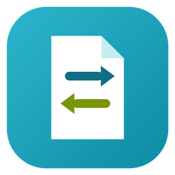

<p align="center">
  
</p>

<h1 align="center">Envy Converter</h1>

<p align="center">
  Conversor de <b>PDF para DOCX</b> (e outros formatos) para Windows, sem corromper arquivos.<br/>
  <i>PDF to DOCX (and more) converter for Windows that never corrupts your files.</i>
</p>

<p align="center">
  <a href="#-português">🇧🇷 Português</a> ·
  <a href="#-english">🇺🇸 English</a>
</p>

<p align="center"><b>Desenvolvido por Bruno Siqueira</b></p>

---

## 🇧🇷 Português

### O que é

O **Envy Converter** é um programa simples para Windows, com interface moderna em tema escuro, que converte:

- **PDF → DOCX** editável (texto, negrito, itálico, fontes, tamanhos, recuos, alinhamento e imagens)
- **PDF → DOCX fiel** (cada página vira uma imagem: idêntico ao PDF, mas o texto não é editável)
- **PDF → DOC, RTF, ODT, HTML e TXT**
- **PDF → PNG ou JPG** (uma imagem por página, em 200 dpi)
- **DOCX, DOC, RTF, ODT, TXT, HTML → PDF** (e entre si)

É um único arquivo `.exe`: **não precisa instalar nada**, nem o .NET.

### Como baixar e usar

1. Vá em **[Releases](../../releases)** e baixe `EnvyConverter-win-x64.zip`.
2. Extraia o zip numa pasta qualquer (ex.: `Documentos\EnvyConverter`).
3. Dê dois cliques em **`EnvyConverter.exe`**.
   - Se aparecer "O Windows protegeu o computador", veja [Aviso do Windows ao abrir](#aviso-do-windows-ao-abrir).
4. **Arraste** os arquivos para a janela (ou clique na área tracejada para escolher). Pode arrastar vários arquivos ou uma pasta inteira.
5. Em **Converter para**, escolha o formato (ex.: **DOCX**).
6. Em **Salvar em**, deixe "Mesma pasta do arquivo original" ou escolha outra pasta.
7. Clique em **Converter**. Quando terminar, clique em **Abrir** ao lado do arquivo para ver o resultado.

> Dica: você também pode arrastar arquivos em cima do `EnvyConverter.exe` ou usar "Abrir com → EnvyConverter".

### Formatos

| Saída | A partir de | Motores |
|---|---|---|
| DOCX | PDF, DOC, RTF, ODT, TXT, HTML | Word, Interno (só PDF), LibreOffice |
| DOCX fiel | PDF | Interno |
| DOC, RTF, ODT, HTML | PDF, DOCX, DOC, RTF, ODT, TXT, HTML | Word, LibreOffice |
| TXT | PDF e os demais | Word, Interno (só PDF), LibreOffice |
| PDF | DOCX, DOC, RTF, ODT, TXT, HTML | Word, LibreOffice |
| PNG, JPG | PDF | Interno |

### Como ele converte (automático)

Você não precisa escolher nada: o programa usa sozinho o melhor motor disponível e, se um falhar, tenta o próximo.

| Motor | Precisa de | Papel |
|---|---|---|
| **Word** | Microsoft Word instalado | 1ª opção: maior fidelidade para PDF → DOCX. Roda escondido. |
| **Interno** | Nada (vem no programa) | Funciona em qualquer Windows 10/11. Reconstrói o texto do PDF em parágrafos editáveis. |
| **LibreOffice** | LibreOffice instalado (gratuito) | Alternativa para DOC, RTF, ODT, HTML e PDF quando não há Word. |

### Aviso do Windows ao abrir

O programa **não pede permissão de administrador** e não instala nada. Mesmo assim, na primeira vez o Windows pode mostrar *"O Windows protegeu o computador"* (SmartScreen). Isso acontece com qualquer `.exe` novo baixado da internet que **não tem assinatura digital** (certificado de código, pago). Clique em **Mais informações → Executar assim mesmo**; depois disso não aparece mais. Para eliminar o aviso de vez, o executável precisa ser assinado com um certificado de assinatura de código.

### Por que não corrompe arquivos

1. **O original nunca é tocado.** O programa faz uma cópia para uma pasta temporária e só trabalha nela. O original é conferido por hash (SHA-256) antes e depois.
2. **O resultado é verificado antes de ser entregue.** Cada arquivo gerado é aberto e checado (DOCX pelo Open XML SDK da Microsoft, PDF pelo PdfPig, ODT/DOC/RTF/PNG/JPG pela estrutura do arquivo).
3. **Se falhar, tenta outro motor.** No modo Automático, uma conversão com problema é descartada e o próximo motor é usado.
4. **Nada é sobrescrito.** Se `arquivo.docx` já existir, o novo vira `arquivo (1).docx`.
5. **Sem arquivo pela metade.** O resultado é gravado com nome temporário e só é renomeado no fim.

### Personalizar as cores

As cores ficam no arquivo **`tema.json`**, ao lado do `.exe`. Abra no Bloco de Notas, troque os valores hexadecimais e abra o programa de novo:

```json
{
  "Fundo": "#0B0F14",
  "Superficie": "#181F27",
  "SuperficieAlta": "#212A34",
  "Borda": "#2C3740",
  "Texto": "#E6EDF3",
  "TextoSuave": "#8B98A5",
  "Destaque": "#2DB8CF",
  "Destaque2": "#0E8AA1",
  "Sucesso": "#4EC9B0",
  "Erro": "#F14C4C",
  "Aviso": "#E8A33D",
  "NomeApp": "Envy Converter"
}
```

`Destaque` e `Destaque2` formam o gradiente dos botões. Se apagar o `tema.json`, o programa usa as cores padrão.

### Trocar o ícone / logo

Substitua `src/EnvyConverter/Assets/app.ico` (ícone do `.exe` e da janela) e `src/EnvyConverter/Assets/app.png` (logo da barra de título, 256×256) e compile de novo.

### Compilar a partir do código

Requisitos: [.NET 8 SDK](https://dotnet.microsoft.com/download/dotnet/8.0).

```bash
dotnet publish src/EnvyConverter/EnvyConverter.csproj -c Release -o publish
```

O executável sai em `publish/EnvyConverter.exe`. Funciona também a partir de Linux/macOS (o projeto usa `EnableWindowsTargeting`).

Teste rápido do motor interno (roda em qualquer sistema):

```bash
dotnet run --project tests/EnvyConverter.Smoke -c Release -- entrada.pdf saida.docx
```

A cada push o GitHub Actions compila no Windows, abre o programa para garantir que a interface inicia e, em tags `v*`, publica o zip em Releases.

### Estrutura

```
src/EnvyConverter/
  MainWindow.xaml(.cs)     interface
  Ui/Theme.xaml            estilos e cores padrão
  Ui/ThemeLoader.cs        leitura do tema.json
  Ui/NativeTitleBar.cs     barra de título nativa do Windows no tema escuro
  Conversion/
    ConversionService.cs   cópia segura, validação, fallback entre motores
    WordEngine.cs          Microsoft Word (automação COM)
    LibreOfficeEngine.cs   LibreOffice (modo invisível)
    BuiltInEngine.cs       motor interno
    PdfLayout.cs           reconstrução de parágrafos a partir do PDF
    DocxWriter.cs          gravação de .docx (Open XML SDK)
    PdfRenderer.cs         renderização de páginas (leitor de PDF do Windows)
    OutputValidator.cs     verificação dos arquivos gerados
tests/EnvyConverter.Smoke/ teste do motor interno
```

### Limitações

- PDFs digitalizados (só imagem, sem texto selecionável) não viram texto editável no motor Interno: use **DOCX fiel** ou o motor **Word**.
- PDFs protegidos por senha não são suportados.
- Tabelas complexas ficam mais fiéis com o motor **Word**.

### Créditos

**Desenvolvido por Bruno Siqueira.** Licença [MIT](LICENSE).

Bibliotecas: [PdfPig](https://github.com/UglyToad/PdfPig) (Apache-2.0) e [Open XML SDK](https://github.com/dotnet/Open-XML-SDK) (MIT).

---

## 🇺🇸 English

### What it is

**Envy Converter** is a simple Windows app with a modern dark UI that converts:

- **PDF → editable DOCX** (text, bold, italic, fonts, sizes, indentation, alignment and images)
- **PDF → faithful DOCX** (each page becomes an image: looks exactly like the PDF, but text is not editable)
- **PDF → DOC, RTF, ODT, HTML and TXT**
- **PDF → PNG or JPG** (one image per page, 200 dpi)
- **DOCX, DOC, RTF, ODT, TXT, HTML → PDF** (and between each other)

It ships as a single `.exe`: **nothing to install**, not even .NET.

### Download and use

1. Go to **[Releases](../../releases)** and download `EnvyConverter-win-x64.zip`.
2. Extract it anywhere.
3. Double-click **`EnvyConverter.exe`**.
   - If you see "Windows protected your PC", see [Windows warning on first launch](#windows-warning-on-first-launch).
4. **Drag** files onto the window (or click the dashed area to browse). Multiple files or a whole folder work.
5. Under **Converter para** (*Convert to*), pick a format (e.g. **DOCX**).
6. Under **Salvar em** (*Save to*), keep "same folder as the original" or choose another folder.
7. Click **Converter**. When done, click **Abrir** (*Open*) next to the file.

> Tip: you can also drop files on `EnvyConverter.exe` or use "Open with → EnvyConverter".

### Formats

| Output | From | Engines |
|---|---|---|
| DOCX | PDF, DOC, RTF, ODT, TXT, HTML | Word, Built-in (PDF only), LibreOffice |
| Faithful DOCX | PDF | Built-in |
| DOC, RTF, ODT, HTML | PDF, DOCX, DOC, RTF, ODT, TXT, HTML | Word, LibreOffice |
| TXT | PDF and the others | Word, Built-in (PDF only), LibreOffice |
| PDF | DOCX, DOC, RTF, ODT, TXT, HTML | Word, LibreOffice |
| PNG, JPG | PDF | Built-in |

### How it converts (automatic)

Nothing to choose: the app picks the best available engine on its own and falls through to the next one if it fails.

| Engine | Requires | Role |
|---|---|---|
| **Word** | Microsoft Word installed | First choice: best fidelity for PDF → DOCX. Runs hidden. |
| **Built-in** | Nothing | Works on any Windows 10/11. Rebuilds PDF text into editable paragraphs. |
| **LibreOffice** | LibreOffice installed (free) | Fallback for DOC, RTF, ODT, HTML and PDF without Word. |

### Windows warning on first launch

The app **never asks for administrator rights** and installs nothing. Windows SmartScreen may still show *"Windows protected your PC"* the first time, as it does for any new **unsigned** `.exe` downloaded from the internet. Click **More info → Run anyway**; it won't show again. Removing it for good requires signing the executable with a code-signing certificate.

### Why files don't get corrupted

1. **The original is never touched.** Work happens on a temp copy; the original's SHA-256 is checked before and after.
2. **Output is verified before delivery.** Every generated file is opened and checked (DOCX via Microsoft's Open XML SDK, PDF via PdfPig, ODT/DOC/RTF/PNG/JPG by file structure).
3. **Automatic fallback.** In Automatic mode a failed conversion is discarded and the next engine is tried.
4. **Nothing is overwritten.** If `file.docx` exists, the new one becomes `file (1).docx`.
5. **No half-written files.** Output is written under a temporary name and renamed at the end.

### Custom colors

Colors live in **`tema.json`** next to the `.exe`. Edit the hex values and restart the app (see the Portuguese section above for the full list of keys). `Destaque` and `Destaque2` form the button gradient. Delete the file to go back to the defaults.

### Changing the icon / logo

Replace `src/EnvyConverter/Assets/app.ico` (exe and window icon) and `src/EnvyConverter/Assets/app.png` (title-bar logo, 256×256) and rebuild.

### Building from source

Requires the [.NET 8 SDK](https://dotnet.microsoft.com/download/dotnet/8.0).

```bash
dotnet publish src/EnvyConverter/EnvyConverter.csproj -c Release -o publish
```

The executable is written to `publish/EnvyConverter.exe`. Cross-building from Linux/macOS also works (`EnableWindowsTargeting`).

Quick test of the built-in engine (any OS):

```bash
dotnet run --project tests/EnvyConverter.Smoke -c Release -- input.pdf output.docx
```

On every push, GitHub Actions builds on Windows, launches the app to make sure the UI starts and, on `v*` tags, publishes the zip to Releases.

### Limitations

- Scanned PDFs (image only) can't become editable text with the Built-in engine: use **Faithful DOCX** or the **Word** engine.
- Password-protected PDFs are not supported.
- Complex tables come out better with the **Word** engine.

### Credits

**Developed by Bruno Siqueira.** [MIT](LICENSE) license.

Libraries: [PdfPig](https://github.com/UglyToad/PdfPig) (Apache-2.0) and [Open XML SDK](https://github.com/dotnet/Open-XML-SDK) (MIT).
